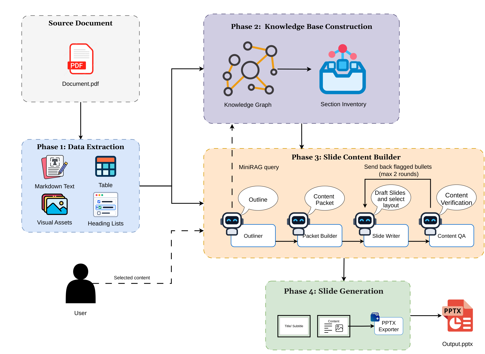

# LoFoSG: Long-Form Slide Generation with Small Language Models (LecSlideGen3)

LoFoSG converts a long academic document (a textbook, a chapter, a paper, a report, lecture material) into an editable,
source-grounded PowerPoint deck (native `.pptx`), using only small language models (SLMs).

Every document first becomes a knowledge graph (heading tree, heading-owned text, concepts, figures and tables with
their own captions) with a section inventory for each heading. Four agents then build the deck section by section: the
**Outliner** plans each section into slides from what the knowledge graph holds for its headings, the **Packet Builder**
decides what each slide's evidence carries, the **Slide Writer** writes each slide and picks a layout that grows to hold
it, and **Content QA** checks every bullet against the sentences it cites, sending flagged bullets back to the writer
(at most two rounds). Every bullet cites the document's own sentences. The full description is in
[`docs/ARCHITECTURE.md`](docs/ARCHITECTURE.md) (written for the code of 2026-10-26).

## System Overview

<p align="center">
  
  <br>
  <i>Figure 1: End-to-end architecture of LoFoSG: data extraction, knowledge base construction, the four-agent slide content builder, and slide generation.</i>
</p>

## Setup

Everything the pipeline needs is in the repository, including the knowledge-graph backend: MiniRAG (HKUDS) is vendored
in `MiniRAG/` with this project's edits (`MiniRAG/VENDOR.md`) and installed from there.

```bash
git clone <repo-url> && cd LecSlideGen3
conda create -n slide python=3.12 -y && conda activate slide
pip install -r requirements.txt
npm install                            
cp .env.example .env                   
```

A CUDA build of torch is optional (MinerU then parses on the GPU).

**Themes and layouts in PowerPoint.** Every generated deck carries the project's named slide layouts and all 30
LecSlide designs under Design > Themes > This Presentation. Nothing is installed into the user's Office profile, so
unrelated presentations never inherit LecSlide themes, templates or colour schemes. Title, body and picture
placeholders use native PowerPoint layout/reset behaviour when content maps one-to-one to a frame; complex diagrams
remain fixed.

## Usage

There is one pipeline and no mode switches. The only choices belong to the knowledge-graph extract step:
`--ocr cloud|auto|none` (how pages are read; `cloud` uses the vision model of `.env`; without it a terminal asks TOC or OCR before the pages are read) and `--llm cloud|local`
(entity extraction on the cloud LLM or a local Ollama server).

```bash
# one document, optionally trimmed to a page range and scoped to some chapters
python main.py --document_path "data/raw/book.pdf" --pages 23-189 \
    --root_heading "Chapter 1. The Machine Learning Landscape;Chapter 2. End-to-End Machine Learning Project"

# every PDF in data/raw/
python main.py --limit 10 --skip-existing

# only the knowledge graph of a PDF (with its kg_view.html)
python extract.py --filepath "data/raw/book.pdf" [--ocr cloud] [--llm local] [--force]

# re-run the last phases on an existing lecture
python -m src.multimodal.multimodal_processing --lecture "data/lectures/<id>/<id>.json"
python -m src.generator.slide_gen --lecture "data/lectures/<id>/<id>.json"
```

## Empirical Performance Evaluation

LoFoSG is evaluated on a collection of 50 academic documents (the document set of PPTAgent, the work that introduced
PPTEval). The 50 PDFs are read one by one, one knowledge graph is built for the whole collection, and one deck is
generated per document. Decks are scored with PPTEval (Content, Design, Coherence, judged by GPT-4o) and with ROUGE-L
against the source text. DocPres and KCTV are compared under the same protocol, each on the same backbone as LoFoSG.

### Table 1: Quality of the generated decks

| Method | Backbone | ROUGE-L | Content | Design | Coherence |
| :--- | :--- | :---: | :---: | :---: | :---: |
| DocPres | Qwen3.5-9B | 11.35 | 2.82 | 2.86 | 3.08 |
| KCTV | Qwen3.5-9B | 8.95 | 2.74 | 3.21 | 3.32 |
| **LoFoSG** | Qwen3.5-9B | **38.55** | **3.43** | **4.16** | **3.94** |
| DocPres | GPT-4.1-mini | 11.60 | 2.92 | 2.36 | 3.12 |
| KCTV | GPT-4.1-mini | 11.88 | 2.71 | 3.03 | 3.70 |
| **LoFoSG** | GPT-4.1-mini | **34.01** | **3.42** | **4.13** | **4.08** |

### Table 2: Robustness and cost per deck

The knowledge-graph build (about 2.38M tokens for the 50 documents, built once and shared) is not included for LoFoSG.

| Method | Backbone | Success rate | Calls | Tokens (k) |
| :--- | :--- | :---: | :---: | :---: |
| DocPres | Qwen3.5-9B | ~69% | 13.0 | 23.7 |
| KCTV | Qwen3.5-9B | ~81% | 5.0 | 9.3 |
| **LoFoSG** | Qwen3.5-9B | **100%** | 19.9 | 61.9 |
| DocPres | GPT-4.1-mini | ~65% | 15.0 | 28.1 |
| KCTV | GPT-4.1-mini | ~81% | 5.0 | 11.9 |
| **LoFoSG** | GPT-4.1-mini | **100%** | 16.8 | 50.2 |

### Table 3: Ablation (GPT-4.1-mini, same 50 documents and same knowledge graph)

| Configuration | ROUGE-L | Content | Design | Coherence | Calls | Tokens (k) |
| :--- | :---: | :---: | :---: | :---: | :---: | :---: |
| without Outliner | 34.52 | 3.40 | 4.06 | 3.90 | 13.5 | 38.7 |
| without QA | 34.01 | 3.41 | 4.05 | 4.00 | 13.8 | 38.7 |
| **Full pipeline** | 34.01 | **3.42** | **4.13** | **4.08** | 16.8 | 50.2 |

### Evaluation Considerations

LoFoSG wrote a deck for every document with both models and scores higher than DocPres and KCTV on every dimension,
with the largest gap in Design. It makes more calls and uses more tokens per deck than the baselines, because each slide
is planned, given its evidence, written and reviewed in separate small calls. The ablation changes Content and Design by
less than 0.1 and Coherence by at most 0.18; PPTEval judges single slides and the flow of a deck, and does not measure
whether each bullet is supported by the sentences it cites or whether every part of the source is covered, which is what
Content QA and the Outliner are designed for.

## Benchmarking Execution

To reproduce the benchmarking results in your local setup (these runs call the models and cost real money):

```bash
# 1. The 50-document collection: one knowledge graph, one deck per document, PPTEval on those decks
python run_collection_benchmark.py --limit 50

# 2. Ablations on the same collection and knowledge graph (decks, then PPTEval)
python run_ablation.py --ablation no_outline
python run_ablation.py --ablation no_qa

# 3. Scores, calls and tokens of the full pipeline and each ablation (reads the disk, no model calls)
python run_ablation.py --summary
python summarize_performance.py --log logs/llm_calls_gpt-4.1-mini.jsonl --only raw_files__
```
