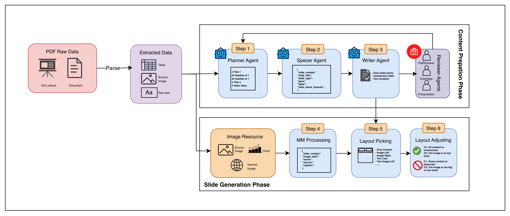

# Summary of Educational Content Generation methods published by members in the VADNgrup (Updating)

This repository contains code for research projects on Educational Content Generation.
We construct this repo into multiple branches for difference projects including:
- **main** branch for summary
- **unified** branch for repo if someone want to study all our projects

*We welcome collaboration from anyone who is passionate about AI and related fields. Please contact our representative at nvietanh.dev@gmail.com. Thank you!*

## Tasks

### 2026
- continue...

- MASG: *Efficient Multi-Agent Slide Generation using Compact Language Models*.

  [Anh V. Nguyen](https://scholar.google.com/citations?user=0MDXqq4AAAAJ&hl=vi), Truong A. Chu, [Tam T. Ngo](https://scholar.google.com/citations?user=VFzbBX0AAAAJ&hl=vi), [Hoa N. Nguyen](https://scholar.google.com/citations?user=8zApxWUAAAAJ&hl=vi&oi=ao)

  [code+data](https://github.com/VADNgrup/ECG/tree/2026-masg)
=======
# LecSlideGen: Automated Lecture Generation Pipeline
## System Overview

<p align="center">
  
  <br>
  <i>Figure 1: End-to-end framework architecture</i>
</p>

## Setup

Everything the pipeline needs is in the repository, including the knowledge-graph backend: MiniRAG (HKUDS) is vendored
in `MiniRAG/` with this project's edits (`MiniRAG/VENDOR.md`) and installed from there.

```bash
git clone <repo-url> && cd LecSlideGen3
conda create -n slide python=3.12 -y && conda activate slide
pip install -r requirements.txt
npm install                            
cp .env.example .env                   
```

A CUDA build of torch is optional (MinerU then parses on the GPU).

**Themes and layouts in PowerPoint.** Every generated deck carries the project's 65 named slide layouts and all 30
LecSlide designs under Design > Themes > This Presentation. Nothing is installed into the user's Office profile, so
unrelated presentations never inherit LecSlide themes, templates or colour schemes. Title, body and picture
placeholders use native PowerPoint layout/reset behaviour when content maps one-to-one to a frame; complex diagrams
remain fixed.

## Usage

There is one pipeline and no mode switches. The only choices belong to the knowledge-graph extract step:
`--ocr cloud|auto|none` (how pages are read; `cloud` uses the vision model of `.env`) and `--llm cloud|local`
(entity extraction on the cloud LLM or a local Ollama server).

```bash
# one document, optionally trimmed to a page range and scoped to some chapters
python main.py --document_path "data/raw/book.pdf" --pages 23-189 \
    --root_heading "Chapter 1. The Machine Learning Landscape;Chapter 2. End-to-End Machine Learning Project"

# every PDF in data/raw/
python main.py --limit 10 --skip-existing

# only the knowledge graph of a PDF (with its kg_view.html)
python extract.py --filepath "data/raw/book.pdf" [--ocr cloud] [--llm local] [--force]

# re-run the last phases on an existing lecture
python -m src.multimodal.multimodal_processing --lecture "data/lectures/<id>/<id>.json"
python -m src.generator.slide_gen --lecture "data/lectures/<id>/<id>.json"
```

## Empirical Performance Evaluation

The system was evaluated utilizing the PPTEval framework (LLM-as-a-Judge architecture) to measure cognitive load distribution, pedagogical adherence, text faithfulness, and generation robustness. The baseline results compare the LecSlideGen parallel multi-agent approach against existing linear-generation solutions (DocPres, KCTV).

### Table 1: Quality and Faithfulness Metrics

| System Architecture | Model Engine | ROUGE-L | Content | Design | Coherence |
| :--- | :--- | :---: | :---: | :---: | :---: |
| DocPres (Baseline) | Qwen3.5-9B | 11.35 | 2.82 | 2.86 | 3.08 |
| KCTV (Baseline) | Qwen3.5-9B | 8.95 | 2.74 | 3.21 | 3.32 |
| **LecSlideGen** (Ours) | **Qwen3.5-9B** | **22.32** | 3.22 | 3.92 | **3.33** |
| **LecSlideGen** (Ours) | **GPT-4.1-mini** | 19.41 | **3.25** | **4.08** | 3.10 |

### Table 2: Robustness and Computational Cost

| System Architecture | Model Engine | Success Rate | Failed Gen | Avg Calls | Token/Output (k) | Done Time (m) |
| :--- | :--- | :---: | :---: | :---: | :---: | :---: |
| DocPres (Baseline) | Qwen3.5-9B | ~69% | 15 | ~13.0 | 23.7 | 2.50 |
| KCTV (Baseline) | Qwen3.5-9B | ~81% | 9 | ~5.0 | 9.3 | 1.30 |
| **LecSlideGen** (Ours) | **Qwen3.5-9B** | **100%** | **0** | 16.4 | 51.1 | 1.37 |
| **LecSlideGen** (Ours) | **GPT-4.1-mini** | **100%** | **0** | 16.6 | 42.3 | **0.85** |

### Evaluation Considerations

The integration of a parallel Reflection layer results in an absolute `100% Success Rate` and significantly enhances layout quality (`Design Score: 4.08`). This mitigates the critical structural failure modes observed in existing frameworks. The compute overhead (API calls and average tokens) represents an acceptable operational trade-off given the elimination of invalid format outputs and near-doubled text adherence (`ROUGE-L`).

## Benchmarking Execution

To reproduce the benchmarking results in your local setup:

```bash
# 1. Run the entire generation and evaluation suite
python run_benchmark.py

# 2. Summarize runtime and quality metrics (automatically filters by model)
python summarize_performance.py --log logs/llm_calls_gpt-4.1-mini.jsonl
```
